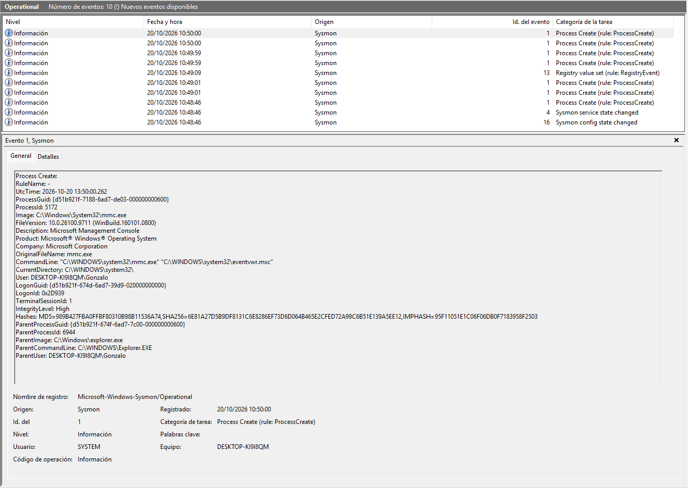
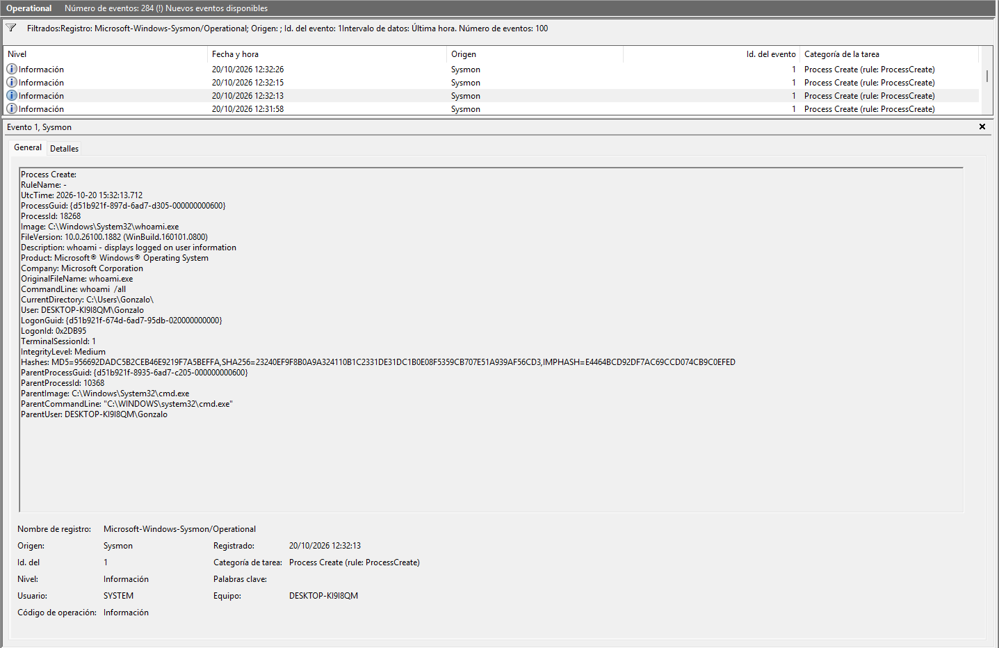
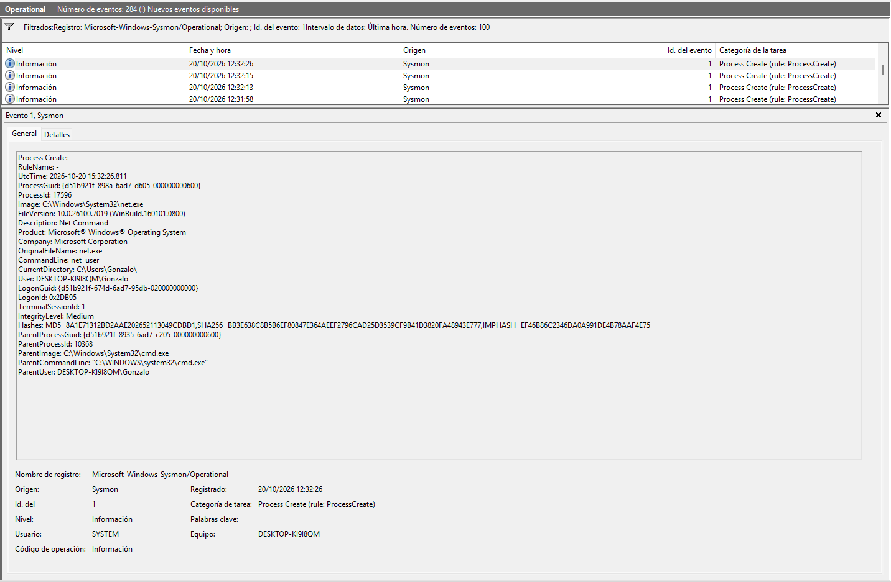
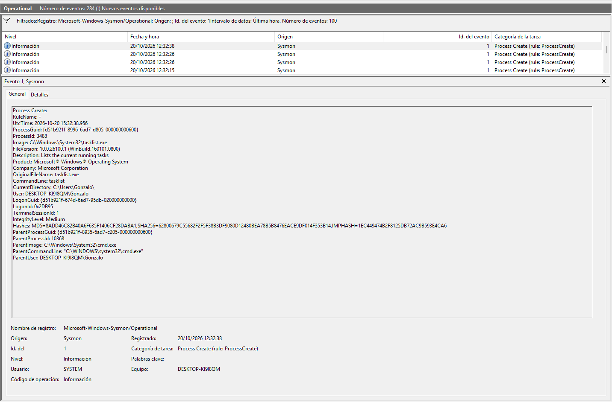
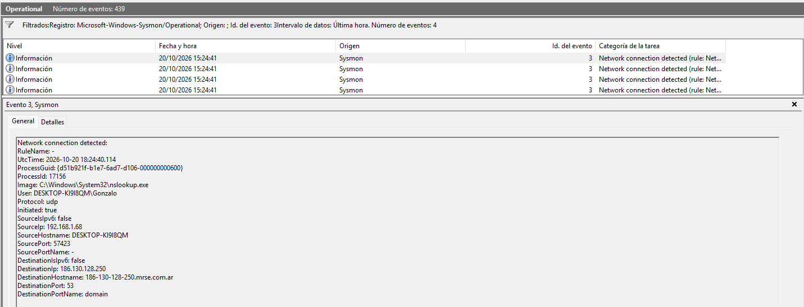

# SOC Home Lab — Telemetría y análisis de eventos en Windows

Laboratorio personal de ciberseguridad defensiva con Sysmon y el Visor de eventos de Windows. Incluye ejecuciones controladas de comandos de descubrimiento, análisis manual de telemetría, una regla Sigma experimental y documentación de un ejercicio simulado con referencia a MITRE ATT&CK.

---

## 📌 Fase 1: Diseño y Arquitectura del Laboratorio

La arquitectura está optimizada para ejecutarse en entornos con recursos limitados (8 GB de RAM), mediante recolección y análisis local de eventos en un equipo Windows:

```text
Ejecución controlada de comandos en Windows
                    ↓
Generación y registro de telemetría con Sysmon
                    ↓
Visualización y filtrado en el Visor de eventos
                    ↓
Análisis manual y documentación de evidencias
                    ↓
Redacción de una regla Sigma experimental
       (despliegue y validación pendientes)

``` 

---

## 📌 Fase 2: Configuración de Telemetría (Sysmon)

Implementación y despliegue de **Microsoft Sysmon64** utilizando la plantilla de configuración optimizada de [SwiftOnSecurity](https://github.com/SwiftOnSecurity/sysmon-config).

* **Eventos clave monitoreados:**
  * `Event ID 1` (Process Create - Creación de procesos)
  * `Event ID 3` (Network Connection - Conexiones de red)
* **Evidencia de visualización local de eventos de Sysmon**
  

  ---

## 📌 Fase 3: Simulación de Ataques y Telemetría

Ejecución controlada de actividades de reconocimiento (*Discovery*) utilizando comandos nativos de Windows (*LOLBins*) para validar la captura de eventos individuales en Sysmon sin comprometer la seguridad del equipo host.

* **Técnicas de descubrimiento estudiadas (MITRE ATT&CK):** 
  * `T1033, T1087.001 y T1057`.

### 1. Consulta de identidad del usuario (T1033 — Descubrimiento del propietario/usuario del sistema)
* **Comando:** `whoami /all`
* **Evidencia Sysmon (Event ID 1):**
  

### 2. Detección de Cuentas de Usuario Locales (T1087.001 — Descubrimiento de cuentas locales)
* **Comando:** `net user`
* **Evidencia Sysmon (Event ID 1):**
  

### 3. Descubrimiento de Procesos Activos (T1057 — Descubrimiento de procesos)
* **Comando:** `tasklist`
* **Evidencia Sysmon (Event ID 1):**
  

---

## 📌 Fase 4: Análisis de Conexiones de Red (Sysmon Event ID 3)

Análisis de conexiones de red registradas por Sysmon durante la ejecución controlada de `nslookup github.com` , con revisión del proceso, protocolo y puerto de destino.

* **Campos clave analizados:**
  * `Image`: `C:\Windows\System32\nslookup.exe`
  * `Protocol`: `udp`
  * `DestinationPort`: `53` (Servicio DNS)
  * `Initiated`: `true` (Conexión iniciada desde el host local)
* **Evidencia de telemetría (Sysmon Event ID 3):**
  

---

## 📌 Fase 5: Ingeniería de Detección (Reglas Sigma)

Regla experimental que busca coincidencias individuales en el campo CommandLine. No correlaciona múltiples eventos ni demuestra ejecución simultánea.

* **Herramienta / Formato:** Reglas Sigma (YAML)
* **Ubicación en el repositorio:** [`detections/detect-recon-discovery.yml`](detections/detect-recon-discovery.yml)
* **Mapeo MITRE ATT&CK de los comportamientos contemplados:**
  * `T1033` — System Owner/User Discovery.
  * `T1087.001` — Account Discovery: Local Account.
  * `T1057` — Process Discovery.

* **Lógica de detección:** Búsqueda de patrones en el campo `CommandLine` de eventos de creación de procesos de Sysmon (Event ID 1), relacionados con `whoami`, `net user` y `tasklist`. Cada evento se evalúa individualmente; la regla no correlaciona una secuencia de comandos.


---

## 📌 Fase 6: Gestión de Incidentes y Reportes de Triaje

Simulación del ciclo de triaje y documentación de respuesta ante incidentes (IR) frente a los eventos registrados durante el ejercicio.

* **Ubicación del Reporte:** [`incidents/INC-2026-001-reconnaissance.md`](incidents/INC-2026-001-reconnaissance.md)
* **Resumen de Investigación:** Análisis de eventos de proceso (Sysmon Event ID 1) y tráfico de red (Event ID 3), documentación de evidencias y definición de mitigación para técnicas MITRE ATT&CK T1033, T1087.001 y T1057.

---

## 📌 Fase 7: Gestión de Configuraciones y Despliegue

Documentación de los perfiles de auditoría y archivos de configuración aplicados para garantizar la repetibilidad del entorno.

* **Ubicación de Configuración:** [`configs/sysmon-config-notes.md`](configs/sysmon-config-notes.md)
* **Perfil Utilizado:** Mapeo de reglas basadas en SwiftOnSecurity para captura fina de Event IDs 1 y 3.

---

# Alcance 
Las actividades documentadas corresponden a un ejercicio autorizado en un equipo propio. No representan un incidente real. La documentación publicada no demuestra un SIEM operativo, correlación automática ni despliegue de la regla Sigma en un motor de detección.
