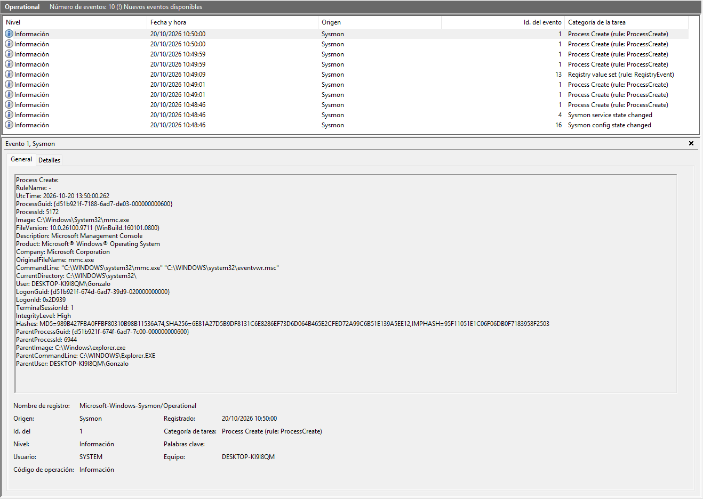
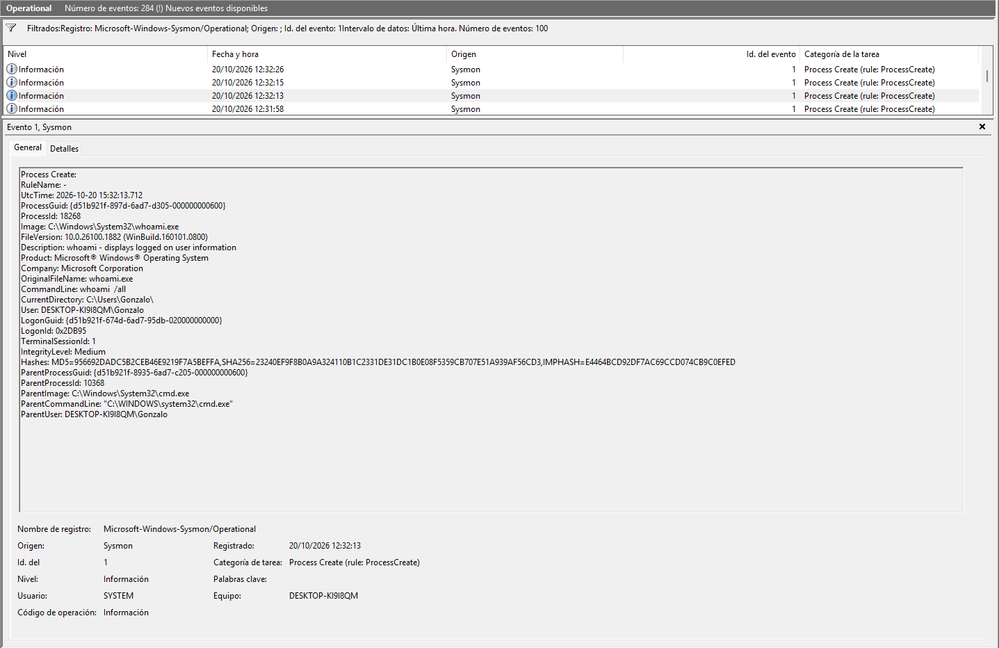
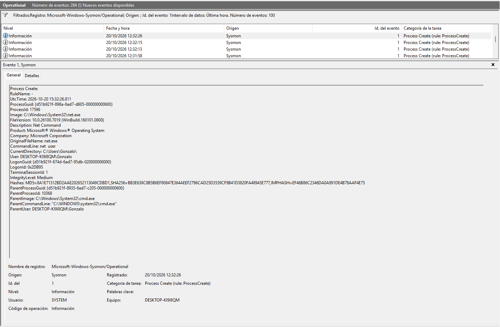
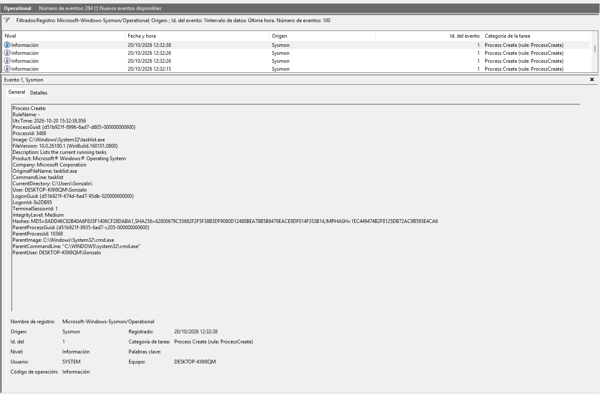
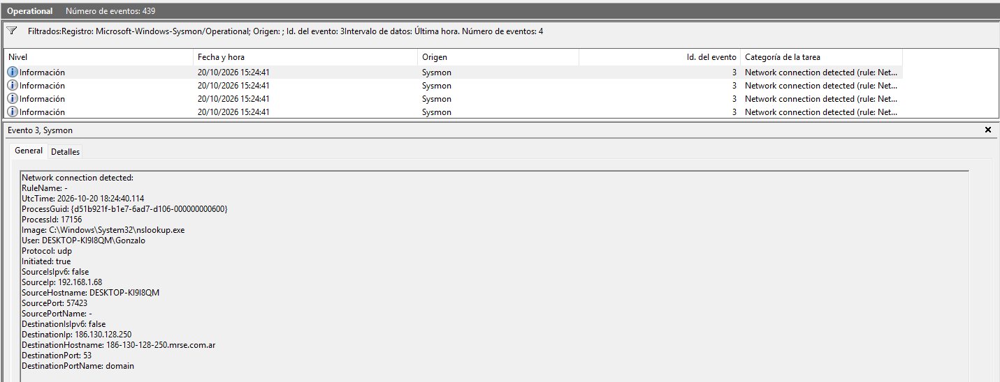

# SOC Home Lab — Threat Detection & Incident Response

Laboratorio práctico de ciberseguridad defensiva diseñado para simular flujos de trabajo de un Analista SOC Tier 1/2, abarcando recolección de telemetría, investigación de incidentes, ingeniería de detección y documentación técnica.

---

## 📌 Fase 1: Diseño y Arquitectura del Laboratorio

La arquitectura está optimizada para ejecutarse en entornos con recursos limitados (8 GB de RAM), utilizando una estructura híbrida basada en telemetría de endpoints y análisis estructurado:

```text
+-----------------------------------------------------------------------+
|                         DELLGON (Host OS)                             |
|                    Windows 11 Home (8 GB RAM)                         |
|                                                                       |
|  +---------------------------+     +-------------------------------+  |
|  |    Fuentes de Telemetría  |     |     Simulación de Ataque      |  |
|  | - Windows Event Logs      |     | - Comandos Nativos (LOLBins)  |  |
|  | - Sysmon (SwiftOnSecurity)| --> | - PowerShell / CMD            |  |
|  +---------------------------+     +-------------------------------+  |
|               |                                                       |
|               v                                                       |
|  +-----------------------------------------------------------------+  |
|  |                 Captura y Filtrado Local                        |  |
|  | - Windows Event Viewer / Telemetría de Sysmon (Event IDs 1, 3)  |  |
|  +-----------------------------------------------------------------+  |
|               |                                                       |
+---------------|-------------------------------------------------------+
                |
                v (Eventos Registrados)
+-----------------------------------------------------------------------+
|                     Análisis & Threat Hunting                         |
|  - Triaje de Eventos y Extracción de IoCs                             |
|  - Asistencia con Inteligencia Artificial (Analista Táctico)          |
|  - Reglas de Detección en formato SIGMA / Mapeo a MITRE ATT&CK        |
+-----------------------------------------------------------------------+
``` 

---

## 📌 Fase 2: Configuración de Telemetría (Sysmon)

Implementación y despliegue de **Microsoft Sysmon64** utilizando la plantilla de configuración optimizada de [SwiftOnSecurity](https://github.com/SwiftOnSecurity/sysmon-config).

* **Eventos clave monitoreados:**
  * `Event ID 1` (Process Create - Creación de procesos)
  * `Event ID 3` (Network Connection - Conexiones de red)
  * `Event ID 11` (File Create - Creación de archivos)
  * `Event ID 22` (DNS Query - Consultas DNS)
* **Evidencia de Ingesta en Tiempo Real:**
  

  ---

## 📌 Fase 3: Simulación de Ataques y Telemetría

Ejecución controlada de actividades de reconocimiento (*Discovery*) utilizando comandos nativos de Windows (*LOLBins*) para validar la captura de eventos individuales en Sysmon sin comprometer la seguridad del equipo host.

* **Técnica simulada (MITRE ATT&CK):** 
  * `T1087` (Account Discovery) y `T1057` (Process Discovery).

### 1. Detección de Identidad y Cuentas (`whoami /all`)
* **Comando:** `whoami /all`
* **Evidencia Sysmon (Event ID 1):**
  

### 2. Detección de Cuentas de Usuario Locales (`net user`)
* **Comando:** `net user`
* **Evidencia Sysmon (Event ID 1):**
  

### 3. Descubrimiento de Procesos Activos (`tasklist`)
* **Comando:** `tasklist`
* **Evidencia Sysmon (Event ID 1):**
  

---

## 📌 Fase 4: Análisis de Conexiones de Red (Sysmon Event ID 3)

Investigación de la telemetría de red para auditar conexiones salientes generadas por procesos del sistema, permitiendo identificar consultas DNS, tráfico sospechoso o comunicación con posibles infraestructuras de comando y control (*C2*).

* **Técnica simulada (MITRE ATT&CK):** 
  * `T1016` (System Network Configuration Discovery).
* **Comando ejecutado:**
  ```powershell
  nslookup github.com
  ```
* **Campos clave analizados:**
  * `Image`: `C:\Windows\System32\nslookup.exe`
  * `Protocol`: `udp`[cite: 7]
  * `DestinationPort`: `53` (Servicio DNS)[cite: 7]
  * `Initiated`: `true` (Conexión iniciada desde el host local)[cite: 7]
* **Evidencia de Detección (Sysmon Event ID 3):**
  

---

## 📌 Fase 5: Ingeniería de Detección (Reglas SIGMA)

Traducción de los hallazgos de investigación en reglas de detección estandarizadas para alertar sobre actividades de reconocimiento en el endpoint.

* **Herramienta / Formato:** Reglas SIGMA (YAML)
* **Ubicación en el repositorio:** [`detections/detect-recon-discovery.yml`](detections/detect-recon-discovery.yml)
* **Mapeo MITRE ATT&CK:** 
  * `T1087` (Account Discovery)
  * `T1057` (Process Discovery)
* **Lógica de la Detección:** Monitoreo de Sysmon (Event ID 1) filtrando patrones en la línea de comandos (`CommandLine`) asociados a la ejecución simultánea o individual de `whoami`, `net user` y `tasklist`.

---

## 📌 Fase 6: Gestión de Incidentes y Reportes de Triaje

Simulación del ciclo de triaje y documentación de respuesta ante incidentes (IR) frente a las alertas de reconocimiento generadas.

* **Ubicación del Reporte:** [`incidents/INC-2026-001-reconnaissance.md`](incidents/INC-2026-001-reconnaissance.md)
* **Resumen de Investigación:** Análisis de eventos de proceso (Sysmon Event ID 1) y tráfico de red (Event ID 3), extracción de IoCs y definición de mitigación para técnicas MITRE T1087 y T1057.

---

## 📌 Fase 7: Gestión de Configuraciones y Despliegue

Documentación de los perfiles de auditoría y archivos de configuración aplicados para garantizar la repetibilidad del entorno.

* **Ubicación de Configuración:** [`configs/sysmon-config-notes.md`](configs/sysmon-config-notes.md)
* **Perfil Utilizado:** Mapeo de reglas basadas en SwiftOnSecurity para captura fina de Event IDs 1, 3, 11 y 22.
